<!-- Generated from data/entries.json. Do not edit by hand. -->

# Agents made the old practices matter more

**Practices in agentic software development, 2026 survey.** Tests, code review and CI carry more weight with coding agents.

```
██████   ██████  ██████   ██████
     ██ ██  ████      ██ ██
 █████  ██ ██ ██  █████  ███████
██      ████  ██ ██      ██    ██
███████  ██████  ███████  ██████
 agentic software development survey
```

**[Take the Agentic Software Development Survey, 2026 →](https://inmve.github.io/agentic-coding-practices/)** Each section of the site ends with a few questions; everyone’s answers go up on 1 December.

- **Site:** [https://inmve.github.io/agentic-coding-practices/](https://inmve.github.io/agentic-coding-practices/) (the same reference with quotes on hover and schemes that play)
- **Data:** [`data/entries.json`](data/entries.json), the single source; this README is generated from it

127 practices, 256 sources, 256 of them with a verbatim quote stored in the data, 65 example schemes. Preliminary edition: dates are not verified yet.

Inside every section the newest practices come first.

## Contents

- [Practices by SDLC stage](#practices-by-sdlc-stage)
  - [Planning & prototyping](#planning--prototyping)
  - [Coding & debugging](#coding--debugging)
  - [Tests and verification](#tests-and-verification)
  - [Review & release](#review--release)
- [Cross-stage](#cross-stage)
  - [Prompts and models](#prompts-and-models)
  - [Agent instructions](#agent-instructions)
  - [Maintaining the agent setup](#maintaining-the-agent-setup)
  - [Context and memory](#context-and-memory)
  - [Parallel work](#parallel-work)
  - [Unattended runs](#unattended-runs)
  - [Steering the agent](#steering-the-agent)
  - [Staying hands-on](#staying-hands-on)
  - [How far the agent is trusted](#how-far-the-agent-is-trusted)
- [Teams and projects](#teams-and-projects)
  - [Approaches](#approaches)
  - [Review rules](#review-rules)
  - [Risk and ownership](#risk-and-ownership)
  - [Contributions to open-source projects](#contributions-to-open-source-projects)
  - [Hiring](#hiring)

## Practices by SDLC stage

### Planning & prototyping

- **Self-contained task with proof**. Each task for the agent is written as a self-contained ticket stating what is wrong, what done looks like and which command proves it.
  Sources: [Addy Osmani, 2026-10-06](https://claude.dev/blog/claude-code-in-the-cloud/); [Addy Osmani, 2026-10-06](https://claude.dev/blog/claude-code-in-the-cloud/).
  Grew from: Behaviour-driven development (2006).

  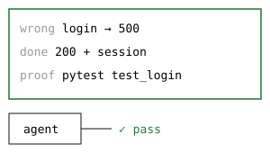

- **Confidence markers on extracted facts**. Every fact the agent extracts from legacy code carries a green, amber or red confidence marker, and ambiguous code is flagged in the output so that a human expert resolves it.
  Sources: [Shashank Mishra, 2026-07-13](https://www.thoughtworks.com/insights/articles/ai-assisted-migration-lessons); [Shashank Mishra, 2026-07-13](https://www.thoughtworks.com/insights/articles/ai-assisted-migration-lessons).

  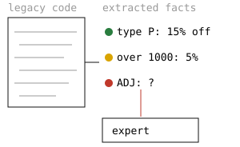

- **Source traceability**. Every fact the agent extracts from legacy code carries a file:line reference back to that code.
  Sources: [Shashank Mishra, 2026-07-13](https://www.thoughtworks.com/insights/articles/ai-assisted-migration-lessons).

  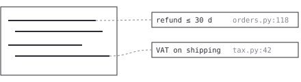

- **Screenshot iteration**. The agent is given a screenshot of the result or of a mock-up, and the change and the screenshot are repeated until they match.
  Sources: [kent-tokyo, 2026-06-03](https://dev.to/kent-tokyo/what-i-do-before-letting-claude-code-touch-web-app-design-53n0).

  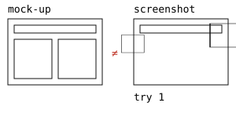

- **Throwaway editor with export**. The agent builds a disposable interface for editing something by hand, and the interface ends with an export button that turns the edits into a prompt or a file.
  Sources: [Thariq Shihipar, 2026-05-20](https://claude.dev/blog/using-claude-code-the-unreasonable-effectiveness-of-html/).
- **Plan before code**. The agent first lays out steps, risks and checks, and the developer corrects that outline before any code is written.
  Sources: [Indragie Karunaratne, 2025-07-01](https://www.indragie.com/blog/i-shipped-a-macos-app-built-entirely-by-claude-code#:~:text=If%20you%20want%20to%20iterate%20on%20the%20plan); [Mitchell Hashimoto, 2025-10-11](https://mitchellh.com/writing/non-trivial-vibing#:~:text=Creating%20a%20comprehensive%20plan); [Addy Osmani, 2026-10-06](https://claude.dev/blog/claude-code-in-the-cloud/).

  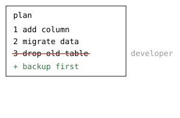

- **Generated prototype**. A project starts with a quickly generated prototype that shows whether the key requirement can be met.
  Sources: [Simon Willison, 2025-03-11](https://simonwillison.net/2025/Mar/11/using-llms-for-code/#:~:text=The%20best%20way%20to%20start%20any%20project); [Alex Grebenyuk, 2025-06-23](https://kean.github.io/post/experiencing-claude-code).
  Grew from: Spike solution.

  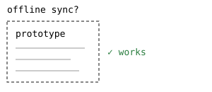

- **Spec walkthrough with the reviewer**. Before the agent writes code, the author walks the future pull request reviewer through the product and technical specs.
  Sources: [Dex](https://github.com/humanlayer/advanced-context-engineering-for-coding-agents/blob/main/wsff.md).
- **Vertical slices in agent work plans**. The agent's work plan for a feature is cut into vertical slices that cross backend and frontend, so that integration is exercised before the end of the work.
  Sources: [shinpr](https://github.com/shinpr/claude-code-workflows); [Dex](https://github.com/humanlayer/advanced-context-engineering-for-coding-agents/blob/main/wsff.md).
  Grew from: Tracer bullets (1999).

  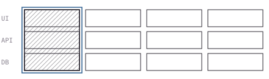

### Coding & debugging

- **Performance fixes from production traces**. The agent is connected to the team's own production traces and asked to find issues on hot code paths, and each resulting pull request links an example trace that shows the extra query or call.
  Sources: [Scott Cooper, 2026-11-03](https://blog.sentry.io/performance-wins-traces-coding-agent/); [Scott Cooper, 2026-11-03](https://blog.sentry.io/performance-wins-traces-coding-agent/).

  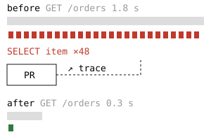

- **Hill climbing on a metric**. An agent is given a measured number to beat and repeatedly changes the code and re-measures until the number improves.
  Sources: [Raymond Wang, Sam Attard, and Issac G., 2026-09-23](https://claude.dev/blog/how-we-made-claude-ai-faster/); [sankalp, 2026-07-08](https://sankalp.bearblog.dev/autoresearch/); [Alberto Gimeno, 2026-09-23](https://github.blog/engineering/user-experience/rendering-huge-pull-requests-in-the-github-copilot-app/).

  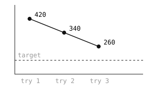

- **Hypotheses from disjoint evidence**. Several agents form hypotheses about a bug from separate, non-overlapping pieces of evidence, so that one early guess does not shape the whole investigation.
  Sources: [Thariq Shihipar and Sid Bidasaria, 2026-06-02](https://claude.dev/blog/a-harness-for-every-task-dynamic-workflows-in-claude-code/).

  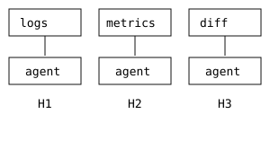

- **Codebase audit with the agent**. The developer asks the agent to audit the codebase for one named problem and talks the findings through with it until a concrete change is clear.
  Sources: [Bram Cohen, 2026-04-05](https://bramcohen.com/p/the-cult-of-vibe-coding-is-insane).
- **CLI tools instead of MCP**. Services are given to the agent as small command-line tools, each with a README that the agent reads only when it needs the tool, instead of MCP servers.
  Sources: [Shrivu Shankar, 2025-11-02](https://blog.sshh.io/p/how-i-use-every-claude-code-feature); [Mario Zechner, 2025-11-30](https://mariozechner.at/posts/2025-11-30-pi-coding-agent/); [Armin Ronacher, 2026-10-06](https://lucumr.pocoo.org/2026/10/6/codemode/); [Peter Steinberger, 2025-12-28](https://steipete.me/posts/2025/shipping-at-inference-speed/).

  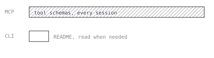

- **Agent feedback loop**. The agent is given a check it can run (tests, a build, a linter) and repeats the change and the check until the check passes.
  Sources: [Indragie Karunaratne, 2025-07-01](https://www.indragie.com/blog/i-shipped-a-macos-app-built-entirely-by-claude-code#:~:text=Claude%20is%20most%20useful%20when); [Addy Osmani, Morgan Westlee Lunt, and Qing Wang, 2026-10-15](https://claude.dev/blog/solving-code-review-at-anthropic/); [Birgitta Böckeler, Chris Ford, 2026-05-13](https://www.thoughtworks.com/insights/blog/generative-ai/harness-engineering-agent-feedback-exploring-ai-coding-sensors).
  Grew from: Continuous integration (1998).

  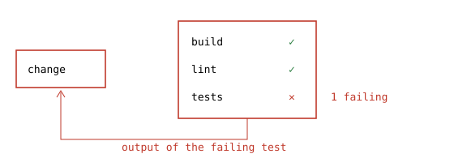

- **Generated code in place of dependencies**. The agent writes the needed code in the project, and a new library is not added.
  Sources: [Armin Ronacher, 2025-06-12](https://lucumr.pocoo.org/2025/6/12/agentic-coding/#:~:text=Be%20even%20more%20conservative%20about); [Ryan Lopopolo, 2026-02-11](https://openai.com/index/harness-engineering/).

  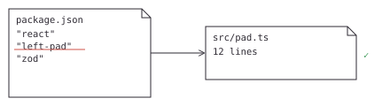

- **Logs for agent debugging**. A system is built with detailed logging, so that an agent can read the logs and find the cause of a problem.
  Sources: [Armin Ronacher, 2025-06-12](https://lucumr.pocoo.org/2025/6/12/agentic-coding/#:~:text=In%20general%20logging%20is%20super%20important); [Alberto Gimeno, 2026-09-23](https://github.blog/engineering/user-experience/rendering-huge-pull-requests-in-the-github-copilot-app/).
- **Simple code for agents**. Code that agents work on is kept simple.
  Sources: [Armin Ronacher, 2025-06-12](https://lucumr.pocoo.org/2025/6/12/agentic-coding/#:~:text=Simple%20code%20significantly%20outperforms%20complex%20code).
  Grew from: KISS.

  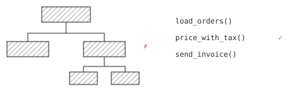

- **Tools built for agents**. The tools an agent calls are made to respond quickly, report errors clearly and withstand misuse.
  Sources: [Armin Ronacher, 2025-06-12](https://lucumr.pocoo.org/2025/6/12/agentic-coding/#:~:text=Tools%20need%20to%20be%20fast); [Shrivu Shankar, 2025-11-02](https://blog.sshh.io/p/how-i-use-every-claude-code-feature).

  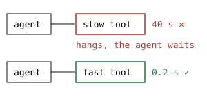

- **Developer-defined structure**. The developer gives function signatures, an outline or scaffolding, and the agent fills in the implementation.
  Sources: [Simon Willison, 2025-03-11](https://simonwillison.net/2025/Mar/11/using-llms-for-code/#:~:text=I%20find%20LLMs%20respond%20extremely%20well); [Anton Zhiyanov, 2025-09-26](https://antonz.org/write-code/#:~:text=Write%20an%20outline%20of%20the%20code%20and%20ask%20AI%20to%20fill%20the%20missing%20parts); [Mitchell Hashimoto, 2025-10-11](https://mitchellh.com/writing/non-trivial-vibing#:~:text=AI%20is%20very%20good%20at%20fill); [Dex](https://github.com/humanlayer/advanced-context-engineering-for-coding-agents/blob/main/wsff.md).
- **Stable libraries**. The developer picks stable libraries that are popular enough for many examples of them to be in the model's training data.
  Sources: [Simon Willison, 2025-03-11](https://simonwillison.net/2025/Mar/11/using-llms-for-code/#:~:text=I%20gain%20enough%20value%20from%20LLMs); [Simon Willison, 2026-03-09](https://simonwillison.net/2026/Mar/9/not-so-boring/).
  Grew from: Choose boring technology (2015).

  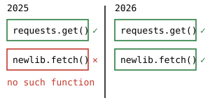

### Tests and verification

- **Tests-as-data**. Tests are kept as data files with the input, the expected output and the setup, read by a small test runner, so that agent changes to the tests are visible and can be blocked.
  Sources: [Matteo Vaccari, 2026-11-11](https://martinfowler.com/articles/tests-as-data.html).

  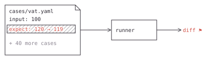

- **Read-only database for the agent**. The agent has access to a read-only copy of the database and validates its query changes there instead of guessing their effect.
  Sources: [Scott Cooper, 2026-11-03](https://blog.sentry.io/performance-wins-traces-coding-agent/).

  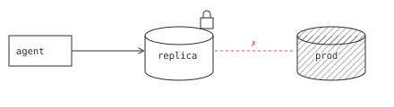

- **Before-and-after recording of a fix**. For a bug fix, the agent reproduces the issue, records the broken behavior, implements the fix and repeats the same steps to show the reviewer the before and after; the team keeps the instructions for this in a skill.
  Sources: [Michael Garfinkle, Mauricio de Meirelles, David Cortes, 2026-10-22](https://shopify.engineering/remote-dev); [Michael Garfinkle, Mauricio de Meirelles, David Cortes, 2026-10-22](https://shopify.engineering/remote-dev).

  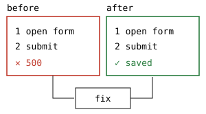

- **Protected test expectations**. Test files and expected results that a task should not change are protected from the agent: made read-only, checked in CI for changes, or named in the agent's instructions as inputs to keep.
  Sources: [Matteo Vaccari, 2026-11-11](https://martinfowler.com/articles/tests-as-data.html); [Naresh Jain, 2026-10-13](https://martinfowler.com/articles/are-harnesses-worth-the-cost.html); [Matteo Vaccari, 2026-11-11](https://martinfowler.com/articles/tests-as-data.html).

  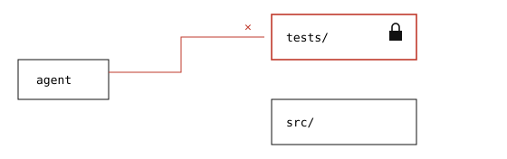

- **Ratcheted benchmark**. Each benchmark an agent optimizes also runs in CI as a guardrail whose threshold may only move in one direction, and benchmarks that are flaky or do not track the real metric are dropped.
  Sources: [Raymond Wang, Sam Attard, and Issac G., 2026-09-23](https://claude.dev/blog/how-we-made-claude-ai-faster/); [Raymond Wang, Sam Attard, and Issac G., 2026-09-23](https://claude.dev/blog/how-we-made-claude-ai-faster/).
- **Tests before agent code**. Tests are written first and shown to fail, and the agent then writes the implementation until they pass.
  Sources: [Arpan Patel, 2026-05-26](https://arps18.github.io/posts/claude-code-mastery/); [Simon Willison](https://simonwillison.net/guides/agentic-engineering-patterns/red-green-tdd/).
  Grew from: Test-driven development (2002).

  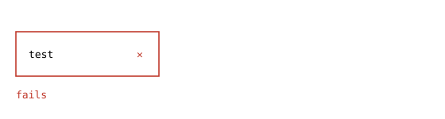

- **Mutation testing of agent-written tests**. Faults are injected into the code under test, by hand, by the agent or by a library in CI, to check that tests written by an agent break with a clear error message.
  Sources: [Matteo Vaccari, 2026-11-11](https://martinfowler.com/articles/tests-as-data.html); [Senko Rašić, 2026-03-22](https://blog.senko.net/improving-ai-generated-tests-using-mutation-testing).
  Grew from: Mutation testing.

  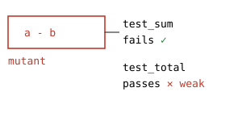

- **Browser checks by an agent**. An agent drives a browser on the running application to check a change against each acceptance criterion and reports what it saw, with screenshots, for each criterion.
  Sources: [Abhishek Ray, 2026-03-10](https://www.claudecodecamp.com/p/i-m-building-agents-that-run-while-i-sleep).

  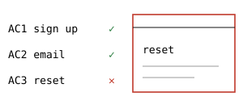

- **Cap on CI rounds per agent run**. An unattended agent gets at most a fixed number of CI rounds per task, two in the source, because every round costs tokens, compute and time.
  Sources: [Alistair Gray, 2026-02-09](https://stripe.dev/blog/minions-stripes-one-shot-end-to-end-coding-agents).

  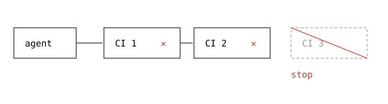

- **Agent-readable test output**. Test and CI output is kept short and fast for the agent: a few lines on screen, details written to a log file, progress printed rarely.
  Sources: [Nicholas Carlini, 2026-02-05](https://www.anthropic.com/engineering/building-c-compiler); [Liz Fong-Jones, 2026-07-16](https://www.honeycomb.io/blog/ai-amplifies-existing-practices-lessons-ai-first-strategy).

  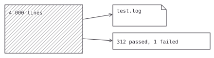

- **Known-good oracle**. The output of agent-written code is compared against an existing known-good implementation, which also narrows down which part of the agent's code is at fault.
  Sources: [Nicholas Carlini, 2026-02-05](https://www.anthropic.com/engineering/building-c-compiler); [Aditya Sharma and Mahesh Kharade, 2026-03-27](https://www.thoughtworks.com/insights/blog/generative-ai/reimagining-api-modernization-with-deterministic-ai-assisted-engineering).

  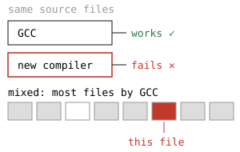

- **Manual verification of agent code**. The developer tests that agent-written code actually works.
  Sources: [Simon Willison, 2025-03-11](https://simonwillison.net/2025/Mar/11/using-llms-for-code/#:~:text=The%20one%20thing%20you%20absolutely%20cannot%20outsource).

  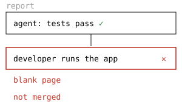

### Review & release

- **Agent chain for alert triage**. An alert passes through a chain of agents: one investigates and writes a plan, a second reviews the plan, and a third opens a pull request with a scoped fix for the on-call engineer.
  Sources: [Ari Salem, 2026-09-03](https://launchdarkly.com/blog/building-a-self-driving-ops-triage-loop/).

  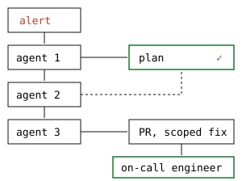

- **First investigation of an alert by an agent**. An agent does the first investigation of a production alert: reads the logs, metrics and code, reports a root cause with its evidence, and leaves any change to production to a person's approval.
  Sources: [Aditya Nugraha, 2026-10-22](https://getstream.io/blog/ai-agent-production-investigation/); [Sachin Malhotra, 2026-08-18](https://claude.com/resources/articles/ai-ci-cd-on-call).

  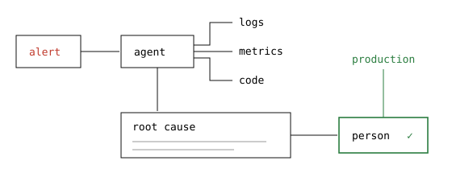

- **Category-specific bug hunting agents**. Agents search parts of an application for one category of vulnerability, a separate verifier agent proves each finding with a test in the application's own test suite, and findings arrive as pull requests.
  Sources: [Zack Deveau, 2026-07-29](https://shopify.engineering/building-an-agentic-harness-that-outlasts-the-model).

  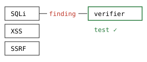

- **Agent-controlled feature flags**. An agent puts its own changes behind feature flags for gradual rollout and reads the flag's results as feedback on whether the change does what it claimed.
  Sources: [Liz Fong-Jones, 2026-07-16](https://www.honeycomb.io/blog/ai-amplifies-existing-practices-lessons-ai-first-strategy); [Sachin Malhotra, 2026-08-18](https://claude.com/resources/articles/ai-ci-cd-on-call).
  Grew from: Feature flags (2009).

  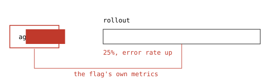

- **One verifier per rule**. A list of rules or claims is checked by separate verifier agents, one for each rule or claim.
  Sources: [Thariq Shihipar and Sid Bidasaria, 2026-06-02](https://claude.dev/blog/a-harness-for-every-task-dynamic-workflows-in-claude-code/); [Thariq Shihipar and Sid Bidasaria, 2026-06-02](https://claude.dev/blog/a-harness-for-every-task-dynamic-workflows-in-claude-code/).

  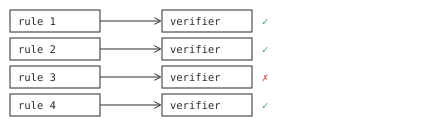

- **Voted review findings**. Several agents look for bugs in a change at the same time, a separate group of agents votes on each finding, and only findings with enough votes are posted.
  Sources: [Addy Osmani, Morgan Westlee Lunt, and Qing Wang, 2026-10-15](https://claude.dev/blog/solving-code-review-at-anthropic/); [Jon Kaplan, 2026-01-15](https://cursor.com/blog/building-bugbot).

  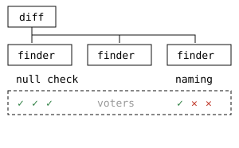

- **Adversarial review**. One agent does the work and a second agent, often on a different model, reviews it with the task of finding problems.
  Sources: [Anthropic](https://www.anthropic.com/engineering/claude-code-best-practices#:~:text=Telling%20Claude%20to%20use%20subagents); [Jesse Vincent, 2025-10-05](https://blog.fsck.com/2025/10/05/how-im-using-coding-agents-in-september-2025/#:~:text=I%20typically%20double); [Arpan Patel, 2026-05-26](https://arps18.github.io/posts/claude-code-mastery/); [Thariq Shihipar and Sid Bidasaria, 2026-06-02](https://claude.dev/blog/a-harness-for-every-task-dynamic-workflows-in-claude-code/); [Zack Deveau, 2026-07-29](https://shopify.engineering/building-an-agentic-harness-that-outlasts-the-model).

  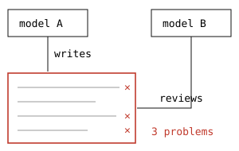

- **Agent self-review**. The agent reviews its own code before a person reviews it.
  Sources: [Chris Dzombak, 2025-08](https://www.dzombak.com/blog/2025/08/getting-good-results-from-claude-code/#:~:text=Asking%20the%20agent%20to%20perform%20a%20code%20review); [Mario Zechner, 2025-11-30](https://mariozechner.at/posts/2025-11-30-pi-coding-agent/); [Addy Osmani, Morgan Westlee Lunt, and Qing Wang, 2026-10-15](https://claude.dev/blog/solving-code-review-at-anthropic/).

  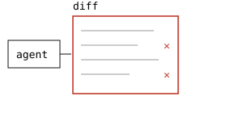

- **Reading agent-written code**. The developer reads the code an agent wrote before accepting it.
  Sources: [Chris Dzombak, 2025-08](https://www.dzombak.com/blog/2025/08/getting-good-results-from-claude-code/#:~:text=Asking%20the%20agent%20to%20perform%20a%20code%20review); [Mitchell Hashimoto, 2025-10-11](https://mitchellh.com/writing/non-trivial-vibing#:~:text=I'm%20not%20shipping%20code); [Mitchell Hashimoto, 2025-10-11](https://mitchellh.com/writing/non-trivial-vibing#:~:text=Please%20don't%20ever%20ship); [Justin Paul, 2026-07-30](https://www.jpaul.me/2026/07/the-workflow-reviewing-ai-code/).

  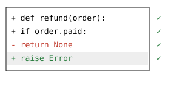

## Cross-stage

### Prompts and models

- **Lookups on smaller subagents**. Verbose reading such as file search, logs and test output goes to subagents on a smaller model, while code edits and decisions stay on the main model.
  Sources: [Addy Osmani, 2026-11-09](https://claude.dev/blog/which-claude-model-should-you-build-with/); [Addy Osmani, 2026-11-09](https://claude.dev/blog/which-claude-model-should-you-build-with/).

  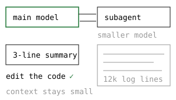

- **Push for bolder attempts**. The agent is told to take more risks and try more ambitious ideas.
  Sources: [Raymond Wang, Sam Attard, and Issac G., 2026-09-23](https://claude.dev/blog/how-we-made-claude-ai-faster/); [sankalp, 2026-07-08](https://sankalp.bearblog.dev/autoresearch/).
- **Model choice per task**. Each step of a task runs on the model that suits it: a cheaper model for routine steps, a more capable one for planning and judging.
  Sources: [Abhishek Ray, 2026-03-10](https://www.claudecodecamp.com/p/i-m-building-agents-that-run-while-i-sleep).
- **Model evals on your own tasks**. A team chooses a model or an agent tool by running the candidates on a sample of its own real tasks, each with a check of the outcome, instead of going by published benchmark scores.
  Sources: [Addy Osmani, 2026-11-09](https://claude.dev/blog/which-claude-model-should-you-build-with/); [Addy Osmani, 2026-11-09](https://claude.dev/blog/which-claude-model-should-you-build-with/); [Simon Rendon Arango, Colin Hallett, 2026-10-16](https://tessl.io/blog/75-of-tessls-prs-now-merge-without-human-review); [David Crawshaw, 2026-02-08](https://crawshaw.io/blog/eight-more-months-of-agents).
- **Model escalation**. Work starts on a faster and cheaper model and moves to a more capable one when the task turns out to be hard.
  Sources: [Sankalp, 2025-07-17](https://sankalp.bearblog.dev/my-claude-code-experience-after-2-weeks-of-usage/#:~:text=Sonnet%204%20handles%2090%25).

  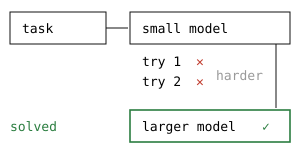

- **“More beautiful” prompt**. The agent is asked to make an interface “more beautiful” or “more elegant”, with no further detail.
  Sources: [Indragie Karunaratne, 2025-07-01](https://www.indragie.com/blog/i-shipped-a-macos-app-built-entirely-by-claude-code#:~:text=If%20Claude%20doesn't%20produce); [David Crawshaw, 2025-06-08](https://crawshaw.io/blog/programming-with-agents).
- **Several options with trade-offs**. The model is asked for several approaches with the pros and cons of each.
  Sources: [Simon Willison, 2025-03-11](https://simonwillison.net/2025/Mar/11/using-llms-for-code/#:~:text=I'll%20use%20prompts%20like); [Thariq Shihipar, 2026-05-20](https://claude.dev/blog/using-claude-code-the-unreasonable-effectiveness-of-html/).

### Agent instructions

- **Single source for agent instructions**. One instruction file is canonical and the files of other agent tools point to it through a pointer line, a symlink or an include.
  Sources: [Przemek, 2026-09-23](https://blog.szypowi.cz/p/claude-code-reads-agents.md-only-when-telemetry-is-on/); [FerroxLabs](https://github.com/FerroxLabs/agents-md).
- **Smallest-scope agent control**. A team corrects an agent behavior with the control of the smallest scope that still gives the wanted output: first interface and output contracts, then automated checks, then skills or commands, and root instruction files last.
  Sources: [Addie Beach, Rui Martins Lacerda, 2026-09-09](https://www.datadoghq.com/blog/ai-development-golden-paths/).
  Grew from: Rules in linters (1978).
- **Gotchas section**. Agent instructions, in a skill or the project instruction file, keep a section of gotchas built from the failure points the agent actually hit, updated over time.
  Sources: [Thariq Shihipar, 2026-06-03](https://claude.dev/blog/lessons-from-building-claude-code-how-we-use-skills/); [Thariq Shihipar, 2026-07-24](https://claude.dev/blog/the-new-rules-of-context-engineering-for-claude-5-generation-models/).
- **Progressive disclosure**. Agent context is split into a tree of files, and the agent is told which files exist so that it reads each one only when it becomes relevant.
  Sources: [Thariq Shihipar, 2026-07-24](https://claude.dev/blog/the-new-rules-of-context-engineering-for-claude-5-generation-models/); [Thariq Shihipar, 2026-06-03](https://claude.dev/blog/lessons-from-building-claude-code-how-we-use-skills/).

  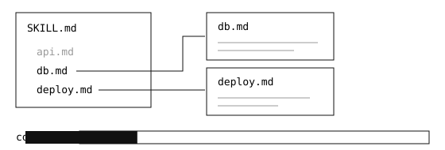

- **Repeated prompt as a skill**. A prompt or workflow that the developer keeps repeating is saved as a skill or command file, checked into git and run by name.
  Sources: [Arpan Patel, 2026-05-26](https://arps18.github.io/posts/claude-code-mastery/).

  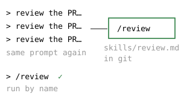

- **Instruction file**. Project instructions for the agent (commands, conventions, constraints) are kept in a text document that the agent reads at the start of every session.
  Sources: [agents.md community](https://agents.md/#:~:text=Think%20of%20AGENTS.md%20as%20a%20README%20for%20agents); [Shrivu Shankar, 2025-11-02](https://blog.sshh.io/p/how-i-use-every-claude-code-feature); [Aditya Sharma and Mahesh Kharade, 2026-03-27](https://www.thoughtworks.com/insights/blog/generative-ai/reimagining-api-modernization-with-deterministic-ai-assisted-engineering).

### Maintaining the agent setup

- **Evals for agent instructions**. A team runs the same agent tasks as evals with and without a change to instruction files or documentation, and keeps the change only after several runs show an improvement.
  Sources: [Addie Beach, Rui Martins Lacerda, 2026-09-09](https://www.datadoghq.com/blog/ai-development-golden-paths/).
- **Regular audit of the agent setup**. Every few weeks, the developer audits the agent setup, including skills, plugins, instruction files and memory, with the tool's check command and reviews which parts still hold true.
  Sources: [Addy Osmani, 2026-08-27](https://addyosmani.com/blog/audit-your-agent-files/).
- **Pruning old constraints**. Constraints added to agent instructions for earlier, weaker models are reviewed and deleted, leaving the agent to rely on context and judgement.
  Sources: [Thariq Shihipar, 2026-07-24](https://claude.dev/blog/the-new-rules-of-context-engineering-for-claude-5-generation-models/).
- **Check that the instruction file is loaded**. The developer checks which instruction file the agent tool actually reads, for example with a marker word, before relying on it.
  Sources: [Systima, 2026-07-12](https://systima.ai/blog/claude-code-vs-opencode-token-overhead); [Przemek, 2026-09-23](https://blog.szypowi.cz/p/claude-code-reads-agents.md-only-when-telemetry-is-on/).
- **Harness engineering**. After each agent mistake, the developer adds a rule, a script or a check to the agent's environment so that the mistake does not happen again.
  Sources: [Mitchell Hashimoto, 2026-02-05](https://mitchellh.com/writing/my-ai-adoption-journey); [Ryan Lopopolo, 2026-02-11](https://openai.com/index/harness-engineering/); [Liz Fong-Jones, 2026-07-16](https://www.honeycomb.io/blog/ai-amplifies-existing-practices-lessons-ai-first-strategy).

  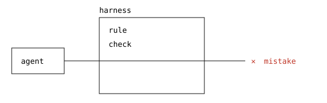

- **Agent session log review**. Saved agent session logs are reviewed regularly, by scripts, people or another agent, for repeated errors and permission requests, and the agent's instructions and tools are changed in response.
  Sources: [Shrivu Shankar, 2025-11-02](https://blog.sshh.io/p/how-i-use-every-claude-code-feature); [Thariq Shihipar and Sid Bidasaria, 2026-06-02](https://claude.dev/blog/a-harness-for-every-task-dynamic-workflows-in-claude-code/); [Michael Garfinkle, Mauricio de Meirelles, David Cortes, 2026-10-22](https://shopify.engineering/remote-dev).
  Grew from: Retrospective (2001).

  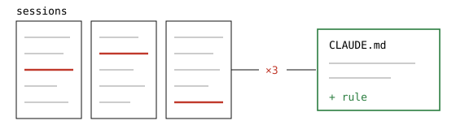

### Context and memory

- **Shared experiment log**. Agents log every attempted idea and its result, and later agent sessions read the log to see whether an idea was already tried.
  Sources: [sankalp, 2026-07-08](https://sankalp.bearblog.dev/autoresearch/).
- **Compaction**. A long agent session is summarized at a milestone or near the context limit, with instructions on what the summary keeps, and work continues in a new context from the summary.
  Sources: [Arpan Patel, 2026-05-26](https://arps18.github.io/posts/claude-code-mastery/).

  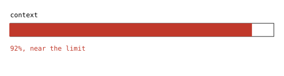

- **Knowledge base from project history**. Agents read the codebase, issues, pull requests and discussion threads and write a knowledge base of unrecorded decisions and conventions, which other agents use when they work on the code.
  Sources: [.txt, 2026-04-29](https://www.thetypicalset.com/blog/thoughts-on-coding-agents).
- **Repository knowledge as the system of record**. Decisions, plans, conventions and other context are kept as versioned files in the repository instead of chats, documents and people's heads, so that agents can read them.
  Sources: [Ryan Lopopolo, 2026-02-11](https://openai.com/index/harness-engineering/); [shinpr](https://github.com/shinpr/claude-code-workflows); [Shashank Mishra, 2026-07-13](https://www.thoughtworks.com/insights/articles/ai-assisted-migration-lessons).
  Grew from: Architecture Decision Records (2011).
- **Document & Clear**. For a large task, the agent writes its plan and progress to a file, the context is cleared, and a new session reads the file and continues the work.
  Sources: [Shrivu Shankar, 2025-11-02](https://blog.sshh.io/p/how-i-use-every-claude-code-feature); [Nicholas Carlini, 2026-02-05](https://www.anthropic.com/engineering/building-c-compiler); [rberg27](https://github.com/rberg27/doom-coding).

  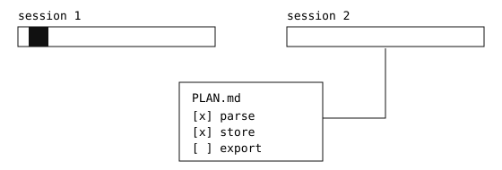

- **Context priming with code**. A session starts by placing existing code into the context, and changes are made from there.
  Sources: [Simon Willison, 2025-03-11](https://simonwillison.net/2025/Mar/11/using-llms-for-code/#:~:text=I%20often%20start%20a%20new%20chat).
- **Documentation for new libraries**. The agent is given current documentation and examples for a library that is missing from the model's training data.
  Sources: [Simon Willison, 2025-03-11](https://simonwillison.net/2025/Mar/11/using-llms-for-code/#:~:text=LLMs%20can%20still%20help%20you%20work%20with%20libraries); [Jude Gao, 2026-01-27](https://vercel.com/blog/agents-md-outperforms-skills-in-our-agent-evals).

### Parallel work

- **Ceiling on parallel agent threads**. The developer sets a ceiling on the number of agent threads run at once, three to four in the source, depending on their complexity.
  Sources: [Addy Osmani, 2026-04-07](https://addyosmani.com/blog/cognitive-parallel-agents/); [Addy Osmani, 2026-04-07](https://addyosmani.com/blog/cognitive-parallel-agents/).

  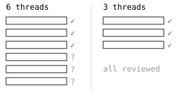

- **Bootable app per worktree**. The application can be started separately in each git worktree, so that every agent runs and checks its own instance.
  Sources: [Ryan Lopopolo, 2026-02-11](https://openai.com/index/harness-engineering/); [Ally Piechowski, 2026-07-28](https://piechowski.io/post/setup-script-git-worktrees/).
- **Task claiming by agents**. Parallel agents take work from a shared list, and an agent claims a task, for example by writing a lock file, before working on it, so that no two agents take the same task.
  Sources: [Nicholas Carlini, 2026-02-05](https://www.anthropic.com/engineering/building-c-compiler); [Barry Zhang, Tianyi Peng, Elle Najt, Keller Scholl, and Lance Martin, 2026-11-09](https://claude.dev/blog/safely-scaling-multi-agent-teams-with-fable-5-2/).

  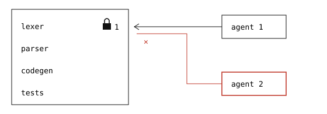

- **Feature sessions**. Each feature or task gets its own agent session, or the context is cleared before an unrelated task begins.
  Sources: [Fabien Sanglard, 2026-08-21](https://fabiensanglard.net/agent.md/index.html); [Lee Robinson, 2026-01-09](https://cursor.com/blog/agent-best-practices); [Addy Osmani, 2026-10-06](https://claude.dev/blog/claude-code-in-the-cloud/); [Anthropic](https://www.anthropic.com/engineering/claude-code-best-practices#:~:text=During%20long%20sessions%2C%20Claude's%20context); [Lydia Hallie, 2026-08-14](https://claude.com/blog/maximizing-the-value-of-your-claude-code-sessions); [Addy Osmani, 2026-09-25](https://claude.dev/blog/what-a-task-costs-on-opus-5-5/).
- **Parallel attempts**. Several agents or models work on the same problem at the same time, each with its own approach, and the developer compares the results.
  Sources: [Lee Robinson, 2026-01-09](https://cursor.com/blog/agent-best-practices); [Thariq Shihipar and Sid Bidasaria, 2026-06-02](https://claude.dev/blog/a-harness-for-every-task-dynamic-workflows-in-claude-code/).
  Grew from: N-version programming (1978).

  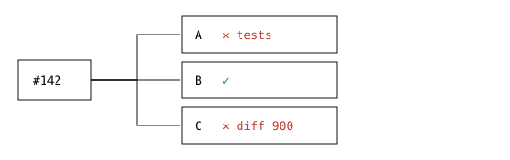

- **Orchestrator and workers**. One agent holds the plan, hands subtasks to worker agents and merges their results.
  Sources: [Anthropic, 2025-06-13](https://www.anthropic.com/engineering/multi-agent-research-system); [Wilson Lin, 2026-01-14](https://cursor.com/blog/scaling-agents); [Thariq Shihipar and Sid Bidasaria, 2026-06-02](https://claude.dev/blog/a-harness-for-every-task-dynamic-workflows-in-claude-code/); [Plawan Rath, Akhil Jindal, Ashwini Verma, 2026-10-19](https://engineering.fb.com/2026/10/19/ml-applications/thin-orchestrator-ai-agent-architecture/).

  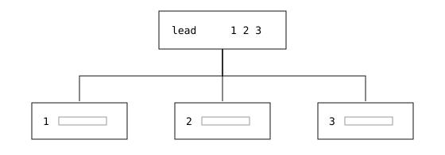

- **Parallel agents**. Several agents work on separate tasks at the same time, each in its own isolated copy of the repository.
  Sources: [David Crawshaw, 2025-06-08](https://crawshaw.io/blog/programming-with-agents#:~:text=We%20are%20exploring%20solving%20both%20of%20these%20issues); [Anthropic](https://docs.anthropic.com/en/docs/claude-code/common-workflows#:~:text=Git%20worktrees%20allow%20you%20to%20check%20out%20multiple%20branches); [Addy Osmani, 2026-10-06](https://claude.dev/blog/claude-code-in-the-cloud/); [Michael Garfinkle, Mauricio de Meirelles, David Cortes, 2026-10-22](https://shopify.engineering/remote-dev).
  Grew from: Feature branch (2009).

### Unattended runs

- **Observable long-running commands**. Long-running tasks are started in terminal panes, such as tmux panes, that the agent observes in real time, instead of the agent sleeping or setting timeouts while it waits.
  Sources: [Michael Garfinkle, Mauricio de Meirelles, David Cortes, 2026-10-22](https://shopify.engineering/remote-dev).
- **Quarantine**. Agents that read untrusted content, such as public issues or messages, are barred from high-privilege actions, and those actions are done by separate agents.
  Sources: [Thariq Shihipar and Sid Bidasaria, 2026-06-02](https://claude.dev/blog/a-harness-for-every-task-dynamic-workflows-in-claude-code/); [Lance Martin and CJ Avilla, 2026-10-08](https://claude.dev/blog/building-effective-agent-automations/).

  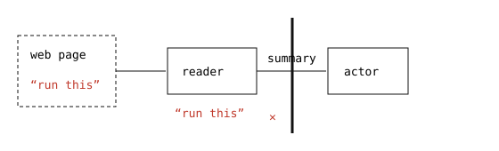

- **Scheduled agent runs**. Agent tasks run on a schedule without anyone starting them: a nightly review of existing code, a recurring cleanup or overnight bug fixes that end in pull requests.
  Sources: [Ryan Lopopolo, 2026-02-11](https://openai.com/index/harness-engineering/); [Anthropic](https://code.claude.com/docs/en/common-workflows); [Addy Osmani, Morgan Westlee Lunt, and Qing Wang, 2026-10-15](https://claude.dev/blog/solving-code-review-at-anthropic/); [Michael Garfinkle, Mauricio de Meirelles, David Cortes, 2026-10-22](https://shopify.engineering/remote-dev); [Georgiana Calancea, 2026-09-10](https://www.deel.com/blog/deel-engineering-rolling-out-with-confidence-pt2/).
- **Warm environment pool for agents**. A team keeps a pool of prepared machines for agents, with the main branch checked out, tools installed, apps built and caches warm, so that an agent claims one instead of waiting for setup.
  Sources: [Michael Garfinkle, Mauricio de Meirelles, David Cortes, 2026-10-22](https://shopify.engineering/remote-dev); [Alistair Gray, 2026-02-09](https://stripe.dev/blog/minions-stripes-one-shot-end-to-end-coding-agents).
- **Disposable machine for the agent**. The agent runs with broad permissions, up to root, on a throwaway machine or virtual machine that has no access to production systems or secrets beyond what development needs.
  Sources: [Granda, 2026-01-02](https://granda.org/en/2026/01/02/claude-code-on-the-go/); [Harper Reed, 2026-09-22](https://harper.blog/2026/09/22/break-away/); [crawshaw, 2026-02-08](https://crawshaw.io/blog/eight-more-months-of-agents).
- **Asynchronous agent work**. The agent works on a task while the developer is busy with something else.
  Sources: [Mitchell Hashimoto, 2025-10-11](https://mitchellh.com/writing/non-trivial-vibing#:~:text=I%20think%20the%20faster); [Granda, 2026-01-02](https://granda.org/en/2026/01/02/claude-code-on-the-go/); [sankalp, 2026-07-08](https://sankalp.bearblog.dev/autoresearch/).
- **Ralph loop**. A harness runs the agent in a loop: when one task finishes, the next run starts, until a stop condition such as no new findings or no errors is met.
  Sources: [Nicholas Carlini, 2026-02-05](https://www.anthropic.com/engineering/building-c-compiler); [Thariq Shihipar and Sid Bidasaria, 2026-06-02](https://claude.dev/blog/a-harness-for-every-task-dynamic-workflows-in-claude-code/); [Geoffrey Huntley, 2025-07-14](https://ghuntley.com/ralph/).

  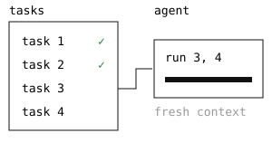

- **Permission-free mode**. The agent's permission prompts are switched off, sometimes inside a container.
  Sources: [Armin Ronacher, 2025-06-12](https://lucumr.pocoo.org/2025/6/12/agentic-coding/#:~:text=I%20disable%20all%20permission%20checks); [Jökull Sólberg, 2025-07-03](https://www.solberg.is/claude-devcontainer).

### Steering the agent

- **Unread throwaway code**. Code generated for a one-off task is run and thrown away without being read.
  Sources: [Oren Eini, 2026-04-21](https://ayende.net/blog/203940-c/using-ai-agents-in-long-lived-software-projects).
- **Early interruption**. The developer stops the agent as soon as it goes in a wrong direction and gives it a correction.
  Sources: [Anthropic](https://www.anthropic.com/engineering/claude-code-best-practices#:~:text=Press%20Escape%20to%20interrupt%20Claude); [Mikayla Maki, 2026-01-23](https://zed.dev/blog/on-programming-with-agents).

  

- **HTML instead of Markdown**. The agent writes plans, explanations and code reviews as HTML pages instead of Markdown documents.
  Sources: [Thariq Shihipar, 2026-05-20](https://claude.dev/blog/using-claude-code-the-unreasonable-effectiveness-of-html/); [Thariq Shihipar, 2026-05-20](https://claude.dev/blog/using-claude-code-the-unreasonable-effectiveness-of-html/); [Nick Keuning, 2026-01-21](https://spin.atomicobject.com/html-spec-driven-development/).

  

- **Change of approach after repeated failures**. After the agent fails at the same problem several times, the developer switches to a different approach.
  Sources: [Mitchell Hashimoto, 2025-10-11](https://mitchellh.com/writing/non-trivial-vibing#:~:text=It's%20at%20this%20point); [Addy Osmani, 2026-08-14](https://addyosmani.com/blog/practical-loop-engineering/).

  

- **Delegation of routine tasks**. Systematic and time-consuming tasks, from renames to large migrations, are handed to the agent.
  Sources: [Alberto Fortin, 2025-05-15](https://albertofortin.com/writing/coding-with-ai#:~:text=I'm%20using%20LLMs,%20but%20for%20dumber%20things); [Raymond Wang, Sam Attard, and Issac G., 2026-09-23](https://claude.dev/blog/how-we-made-claude-ai-faster/); [Michael Garfinkle, Mauricio de Meirelles, David Cortes, 2026-10-22](https://shopify.engineering/remote-dev).
  Grew from: Codemods (2008).
- **Repeated rework requests**. The developer asks the agent to rework the code as many times as it takes to reach an acceptable result.
  Sources: [Simon Willison, 2025-03-11](https://simonwillison.net/2025/Mar/11/using-llms-for-code/#:~:text=If%20I%20don't%20like%20what%20an%20LLM%20has%20written); [Alex Grebenyuk, 2025-06-23](https://kean.github.io/post/experiencing-claude-code).

### Staying hands-on

- **Explainer for a code slice**. A person who wants to understand part of a codebase asks the agent to write an explainer for exactly that part.
  Sources: [Addy Osmani, Morgan Westlee Lunt, and Qing Wang, 2026-10-15](https://claude.dev/blog/solving-code-review-at-anthropic/).
- **Retyping agent code by hand**. The agent shows its proposed code in the chat and the developer types every edit into the project by hand.
  Sources: [Ankur Sethi, 2026-08-02](https://ankursethi.com/blog/prevent-cognitive-debt-by-manually-retyping-llm-generated-code/).
- **Deliberate practice without agents**. An engineer now and then solves a problem without an agent, even one the agent could solve, to keep their own skills.
  Sources: [Saffron Huang, Bryan Seethor, Esin Durmus, Kunal Handa, Miles McCain, Michael Stern, Deep Ganguli, 2025-12-02](https://www.anthropic.com/research/how-ai-is-transforming-work-at-anthropic).
- **Manual refinement of agent output**. The developer reworks the agent's implementation by hand after the agent has finished.
  Sources: [Mitchell Hashimoto, 2025-10-11](https://mitchellh.com/writing/non-trivial-vibing#:~:text=I%20almost%20always%20go%20in); [Conrad Irwin](https://zed.dev/blog/not-building-ai-for-the-money).
- **Critical parts by hand**. The developer writes the critical and complex parts of the code and hands the rest to the agent.
  Sources: [Anton Zhiyanov, 2025-09-26](https://antonz.org/write-code/#:~:text=Write%20the%20critical%20parts%20and%20ask%20AI%20to%20do%20the%20rest).

  

- **Own draft first**. The developer drafts the solution without an agent and then gives it to an agent to review and improve.
  Sources: [Anton Zhiyanov, 2025-09-26](https://antonz.org/write-code/#:~:text=Write%20the%20initial%20version%20yourself%20and%20ask%20AI%20to%20review%20and%20improve%20it).

  

- **Agent as a pair partner**. The developer works with the agent as with a pair partner: thinks a problem through aloud with it, nudges it when needed, then reviews, refactors and tests the result.
  Sources: [Orta Therox, 2025-06-07](https://blog.puzzmo.com/posts/2025/06/07/orta-on-claude/#:~:text=Claude%20Code%20feels%20like%20pairing).
  Grew from: Pair programming (1998), Rubber duck debugging.
- **Learning with an agent**. The developer uses an agent to learn a language or a concept and then applies it when writing code.
  Sources: [Alberto Fortin](https://albertofortin.com/writing/coding-with-ai#:~:text=I'm%20leveraging%20them%20to%20learn%20Go).

### How far the agent is trusted

Rules about what an agent may do without a person checking it: how deep the review goes, what the agent may not touch, where it runs. Every practice here also stands in its own section above.

These practices also stand in their own sections above, with their sources.

- **Approval bound to a commit**. A review approval covers one specific commit, and new commits the system cannot vouch for, such as an agent's push or a hand-resolved merge, require approval again.
- **Prompter as a required reviewer**. The person who directed the agent counts as one of the required reviewers of its pull request, and an agent's approval never counts as a person's.
- **CI workflow files as high risk**. The files that define the CI pipeline are treated as high risk, because an agent that can edit the pipeline can weaken the review of its own work.
- **Protected test expectations**. Test files and expected results that a task should not change are protected from the agent: made read-only, checked in CI for changes, or named in the agent's instructions as inputs to keep.
- **Named owner of an agent thread**. Every line of agent work has a named person who owns it, and the agent shows user-visible changes to that person with before-and-after screenshots or recordings.
- **Risk-based code review**. The depth of review for a change depends on its risk: a low-risk change gets a light check or merges automatically, everything else gets full review, and some kinds of code are kept out of automated review.
- **Track record before landing without review**. A recurring automated source of code changes, such as a fixed prompt that an agent runs again and again, may land its changes without a person reviewing each one only after a clean record over a set period: no incidents, few reverts, few rejections by people and enough landed changes; a source that caused an incident is blocked.
- **Quarantine**. Agents that read untrusted content, such as public issues or messages, are barred from high-privilege actions, and those actions are done by separate agents.
- **Unread throwaway code**. Code generated for a one-off task is run and thrown away without being read.
- **Agent review of every pull request**. A team has an agent review every pull request, and review by a person becomes optional.
- **Disposable machine for the agent**. The agent runs with broad permissions, up to root, on a throwaway machine or virtual machine that has no access to production systems or secrets beyond what development needs.
- **Extra approval for agent pull requests**. Pull requests started by an agent or generated by a model must clear a higher bar than other pull requests, such as more human approvals or required tests.
- **Critical parts by hand**. The developer writes the critical and complex parts of the code and hands the rest to the agent.
- **Reading agent-written code**. The developer reads the code an agent wrote before accepting it.
- **Permission-free mode**. The agent's permission prompts are switched off, sometimes inside a container.

## Teams and projects

Rules that teams and open-source projects set for work with agents.

### Approaches

- **Software factory**. People neither write nor review the code: specifications and scenarios drive agents that write the code and run the checks until they pass.
  Sources: [Justin McCarthy, 2026-02-06](https://factory.strongdm.ai/); [Ryan Lopopolo, 2026-02-11](https://openai.com/index/harness-engineering/); [Addy Osmani, 2026-07-20](https://addyosmani.com/blog/software-factories/); [Dan Shapiro, 2026-01-23](https://www.danshapiro.com/blog/2026/01/the-five-levels-from-spicy-autocomplete-to-the-software-factory/).
- **Spec-driven development**. Well-crafted requirement specifications serve as the prompts from which coding agents generate the code; in its strictest form the specification is the only thing the developer edits.
  Sources: [GitHub Engineering, 2025-09-30](https://github.blog/ai-and-ml/generative-ai/spec-driven-development-using-markdown-as-a-programming-language-when-building-with-ai/); [Liu Shangqi, 2025-12-04](https://www.thoughtworks.com/insights/blog/agile-engineering-practices/spec-driven-development-unpacking-2025-new-engineering-practices).
  Grew from: Waterfall.

  

- **Vibe coding** (2025). Building software by talking to an agent without reading the code: every change is accepted, errors are pasted back until it works.
  Sources: [Andrej Karpathy, 2025-02-02](https://x.com/karpathy/status/1886192184808149383).

  

### Review rules

- **Approval bound to a commit**. A review approval covers one specific commit, and new commits the system cannot vouch for, such as an agent's push or a hand-resolved merge, require approval again.
  Sources: [Addy Osmani, Morgan Westlee Lunt, and Qing Wang, 2026-10-15](https://claude.dev/blog/solving-code-review-at-anthropic/); [Maksym Kuzmitskyi, 2026-10-19](https://dev.to/maximusft/a-review-belongs-to-a-commit-2a5b).

  

- **Prompter as a required reviewer**. The person who directed the agent counts as one of the required reviewers of its pull request, and an agent's approval never counts as a person's.
  Sources: [Addy Osmani, Morgan Westlee Lunt, and Qing Wang, 2026-10-15](https://claude.dev/blog/solving-code-review-at-anthropic/); [Addy Osmani, Morgan Westlee Lunt, and Qing Wang, 2026-10-15](https://claude.dev/blog/solving-code-review-at-anthropic/).
  Grew from: Pull request (2008).
- **Answer to every review finding**. Every finding of the review agent must be fixed or resolved with a stated reason, and a pull request cannot merge while a bug or security finding is open.
  Sources: [Addy Osmani, Morgan Westlee Lunt, and Qing Wang, 2026-10-15](https://claude.dev/blog/solving-code-review-at-anthropic/); [Addy Osmani, Morgan Westlee Lunt, and Qing Wang, 2026-10-15](https://claude.dev/blog/solving-code-review-at-anthropic/); [Christopher Olsen, 2026-08-06](https://brainchurts.com/lessons/2026-08-06-ai-reviewer-in-the-merge-gate).

  

- **Volunteer-only review of model-written pull requests**. A project assigns pull requests written with a language model only to reviewers who volunteer for them, and such a reviewer may ask the author to redo the change without generated code.
  Sources: [Jynn Nelson, 2026-08-05](https://blog.rust-lang.org/inside-rust/2026/08/05/rust-langrust-is-adopting-an-llm-policy/).
- **Agent review of every pull request**. A team has an agent review every pull request, and review by a person becomes optional.
  Sources: [Ryan Lopopolo, 2026-02-11](https://openai.com/index/harness-engineering/); [OpenAI](https://developers.openai.com/codex/learn/best-practices); [Dave North, 2026-06-01](https://rewind.com/blog/ai-approve-pull-requests-safely/).
  Grew from: Pull request (2008).
- **Extra approval for agent pull requests**. Pull requests started by an agent or generated by a model must clear a higher bar than other pull requests, such as more human approvals or required tests.
  Sources: [Shrivu Shankar, 2025-11-02](https://blog.sshh.io/p/how-i-use-every-claude-code-feature); [Jynn Nelson, 2026-08-05](https://blog.rust-lang.org/inside-rust/2026/08/05/rust-langrust-is-adopting-an-llm-policy/).
  Grew from: Pull request (2008).
- **Intent Review**. For medium- and high-risk pull requests, an agent guides the engineer through how the change affects the system, with understanding of the change, not approval, as the goal.
  Sources: [Vinay Perneti and Emma Webb](https://www.augmentcode.com/downloads/state-of-ai-native-engineering-2026.pdf).
  Grew from: Code walkthrough (1974).

### Risk and ownership

- **CI workflow files as high risk**. The files that define the CI pipeline are treated as high risk, because an agent that can edit the pipeline can weaken the review of its own work.
  Sources: [Jonathan Wage, 2026-10-13](https://blog.traderspost.io/article/risk-proportional-review-for-ai-agents).
- **Named owner of an agent thread**. Every line of agent work has a named person who owns it, and the agent shows user-visible changes to that person with before-and-after screenshots or recordings.
  Sources: [Raymond Wang, Sam Attard, and Issac G., 2026-09-23](https://claude.dev/blog/how-we-made-claude-ai-faster/).
- **Ownership of agent controls**. Shared agent controls used by many teams, such as skills, commands and root-level instruction files, have an owning team or guild.
  Sources: [Addie Beach, Rui Martins Lacerda, 2026-09-09](https://www.datadoghq.com/blog/ai-development-golden-paths/).
- **Risk-based code review**. The depth of review for a change depends on its risk: a low-risk change gets a light check or merges automatically, everything else gets full review, and some kinds of code are kept out of automated review.
  Sources: [Jonathan Wage, 2026-10-13](https://blog.traderspost.io/article/risk-proportional-review-for-ai-agents); [Spotify Engineering](https://engineering.atspotify.com/2026/6/code-with-claude-coding-is-no-longer-the-constraint); [Chris Adams et al., 2026-06-12](https://arxiv.org/html/2605.30208).

  

- **Track record before landing without review**. A recurring automated source of code changes, such as a fixed prompt that an agent runs again and again, may land its changes without a person reviewing each one only after a clean record over a set period: no incidents, few reverts, few rejections by people and enough landed changes; a source that caused an incident is blocked.
  Sources: [Chris Adams et al., 2026-06-12](https://arxiv.org/html/2605.30208); [Chris Adams et al., 2026-06-12](https://arxiv.org/html/2605.30208); [Chris Adams et al., 2026-06-12](https://arxiv.org/html/2605.30208).

  

- **Agent questions in incident retrospectives**. A team's regular incident retrospective adds two questions: whether agent-written code contributed to the incident, and whether the larger volume of change strained review, testing, rollout or observability.
  Sources: [Tyson Singer](https://engineering.atspotify.com/2026/9/ai-changed-how-spotify-builds-what-we-learned-and-fixed-about-quality-at-higher-velocity/).
  Grew from: Retrospective (2001).

### Contributions to open-source projects

- **Analyze, not create**. A project lets contributors use language models to answer questions, analyze, check and review their work, but not to create the content they submit.
  Sources: [Jynn Nelson, 2026-08-05](https://blog.rust-lang.org/inside-rust/2026/08/05/rust-langrust-is-adopting-an-llm-policy/); [OpenJDK Governing Board](https://openjdk.org/legal/ai).
- **Agents in project spaces only with approval**. An agent may comment on or act in shared project spaces only after people approve it or explicitly invoke it.
  Sources: [rnk, 2025-12-17](https://discourse.llvm.org/t/rfc-llvm-ai-tool-policy-human-in-the-loop/89159); [Wirasm](https://github.com/Wirasm/prp).

  

- **Contributor review of generated code**. A project requires contributors to read and review all generated code or text, and to be able to explain it, before they ask maintainers for review.
  Sources: [rnk, 2025-12-17](https://discourse.llvm.org/t/rfc-llvm-ai-tool-policy-human-in-the-loop/89159).
- **Disclosure of agent use**. Contributors state in the pull request, commit message or post whether and how a model or agent produced the content.
  Sources: [rnk, 2025-12-17](https://discourse.llvm.org/t/rfc-llvm-ai-tool-policy-human-in-the-loop/89159); [Jynn Nelson, 2026-08-05](https://blog.rust-lang.org/inside-rust/2026/08/05/rust-langrust-is-adopting-an-llm-policy/).
- **Extractive contribution handling**. Maintainers who judge a generated contribution to cost more review time than it is worth reply with a standard request, label it, and stop engaging or close it.
  Sources: [rnk, 2025-12-17](https://discourse.llvm.org/t/rfc-llvm-ai-tool-policy-human-in-the-loop/89159); [Jynn Nelson, 2026-08-05](https://blog.rust-lang.org/inside-rust/2026/08/05/rust-langrust-is-adopting-an-llm-policy/).

  

- **Own words in project communication**. A project requires issues, pull request descriptions, comments and replies to review to be written in the contributor's own words, not pasted model output.
  Sources: [rnk, 2025-12-17](https://discourse.llvm.org/t/rfc-llvm-ai-tool-policy-human-in-the-loop/89159); [Jellyfin project](https://jellyfin.org/docs/general/contributing/llm-policies/).
- **Ban on generated contributions**. A project does not accept contributions that include content generated, in part or in full, by language models or similar systems.
  Sources: [OpenJDK Governing Board](https://openjdk.org/legal/ai); [Daniel P. Berrangé, 2024-05-16](https://patchew.org/QEMU/20240516162230.937047-1-berrange@redhat.com/20240516162230.937047-4-berrange@redhat.com/).

### Hiring

- **Build session in the interview**. An interview gives the candidate a few hours to build a working prototype with coding agents and tools of their choice.
  Sources: [Applied Intuition, 2026-07-22](https://www.appliedintuition.com/engineering-blog/hiring-engineers-age-of-agents); [DigitalOcean, 2026-06-09](https://digitalocean.com/blog/ai-native-engineering-interview).

  

- **Review of a draft change in the interview**. A candidate reviews and improves a colleague's draft pull request in an unfamiliar codebase, with agents allowed.
  Sources: [Sierra, 2026-04-22](https://sierra.ai/blog/the-ai-native-interview).
- **Agent session transcripts in the take-home**. A candidate submits the transcripts of their sessions with the agent as part of the take-home, next to the code and the demo.
  Sources: [Quentin Rousseau, 2026-02-24](https://rootly.com/blog/re-thinking-candidates-take-homes-in-the-ai-era-transcripts-over-code).

  

- **Take-home built for work with agents**. A take-home allows agents and is built around a longer problem that an agent does not solve whole, with starter code that leaves the tooling to the candidate.
  Sources: [Tristan Hume, 2026-01-21](https://anthropic.com/engineering/AI-resistant-technical-evaluations); [Tristan Hume, 2026-01-21](https://anthropic.com/engineering/AI-resistant-technical-evaluations).
- **Assessing how a candidate directs agents**. Interviewers score how a candidate plans the work, steers the agent and checks what it produced.
  Sources: [Elicit, 2026-03-30](https://elicit.com/blog/engineering-interviews-in-the-era-of-agents); [Augment Code, 2026-03-12](https://augmentcode.com/blog/how-we-hire-ai-native-engineers-now); [Karl Hörnlund, 2025-10-20](https://www.canva.dev/blog/engineering/ai-interview-success/).
- **Interviews without agents**. Some interviews are deliberately held without agents, next to interviews where agents are expected.
  Sources: [Elicit, 2026-03-30](https://elicit.com/blog/engineering-interviews-in-the-era-of-agents); [Applied Intuition, 2026-07-22](https://www.appliedintuition.com/engineering-blog/hiring-engineers-age-of-agents); [Anthropic, 2025-07-10](https://www.anthropic.com/candidate-ai-guidance).
- **Candidate's own agents in the interview**. A candidate may use their own coding agents and tools during an interview, the same ones they would use at work.
  Sources: [Elicit, 2026-03-30](https://elicit.com/blog/engineering-interviews-in-the-era-of-agents); [Omnea, 2026-05-26](https://www.omnea.co/resource/ai-in-our-programming-interviews); [Simon Newton, 2025-06-11](https://canva.dev/blog/engineering/yes-you-can-use-ai-in-our-interviews).

## Contributing

See [CONTRIBUTING.md](CONTRIBUTING.md): open an issue or a pull request that changes `data/entries.json`.
